  
  
  
  

### 👋 Hi, I'm Sergei

Front-end developer based in **Novi Sad 🇷🇸**. I build sites and web apps with **TypeScript, React, Next.js and Astro**, and I care about the details: motion, typography and pages that load fast.

### 🚀 Featured projects

<table>
  <tr>
    <td width="50%" valign="top">
      
<b><a href="https://github.com/iamlykke/my-blog">Concerts Archive</a></b>

      
Every concert I've been to since 2011: artists, cities and venues on an interactive map.

      
<code>Next.js 16</code> <code>React 19</code> <code>Tailwind 4</code> <code>MDX</code> <code>Leaflet</code>

    </td>
    <td width="50%" valign="top">
      
<b><a href="https://github.com/iamlykke/personal-site">Personal site</a></b>

      
A one-screen bento portfolio with two moods you can switch between: Casual and Formal.

      
<code>Astro</code> <code>TypeScript</code> <code>GSAP</code>

    </td>
  </tr>
  <tr>
    <td width="50%" valign="top">
      
<b><a href="https://github.com/iamlykke/vojvodina-fc">FK Vojvodina</a></b>

      
A redesign of the football club's website in three languages: Latin, Cyrillic and English.

      
<code>Next.js 16</code> <code>App Router</code> <code>CSS Modules</code> <code>i18n</code>

    </td>
    <td width="50%" valign="top">
      
<b><a href="https://github.com/iamlykke/brand-guidelines">Brand Guidelines</a></b>

      
An interactive brand book for Redo: strategy, logo, color, typography and art direction.

      
<code>Astro</code> <code>CSS</code>

    </td>
  </tr>
  <tr>
    <td width="50%" valign="top">
      
<b><a href="https://github.com/iamlykke/insta-unfollowers">Insta Unfollowers</a></b>

      
A small tool that shows who doesn't follow you back on Instagram.

      
<code>Astro</code> <code>React</code> <code>shadcn/ui</code> <code>Tailwind</code>

    </td>
    <td width="50%" valign="top">
      
<b><a href="https://github.com/iamlykke/austris-app">Austris</a></b> <i>in progress</i>

      
An online shop for handmade candles, with Supabase as the backend.

      
<code>Next.js</code> <code>Supabase</code> <code>Tailwind</code> <code>Swiper</code>

    </td>
  </tr>
</table>

### 🛠️ Stack

  &nbsp;&nbsp;
  &nbsp;&nbsp;
  &nbsp;&nbsp;
  &nbsp;&nbsp;
  &nbsp;&nbsp;
  &nbsp;&nbsp;
  &nbsp;&nbsp;
  &nbsp;&nbsp;
  

  &nbsp;&nbsp;
  &nbsp;&nbsp;
  &nbsp;&nbsp;
  &nbsp;&nbsp;
  &nbsp;&nbsp;
  &nbsp;&nbsp;
  &nbsp;&nbsp;
  &nbsp;&nbsp;
  

### 📊 What I write in

  

### 🗣️ Languages I speak

🇬🇧 English &nbsp;·&nbsp; 🇷🇺 Russian &nbsp;·&nbsp; 🇷🇸 Serbian &nbsp;·&nbsp; 🇪🇸 Spanish
